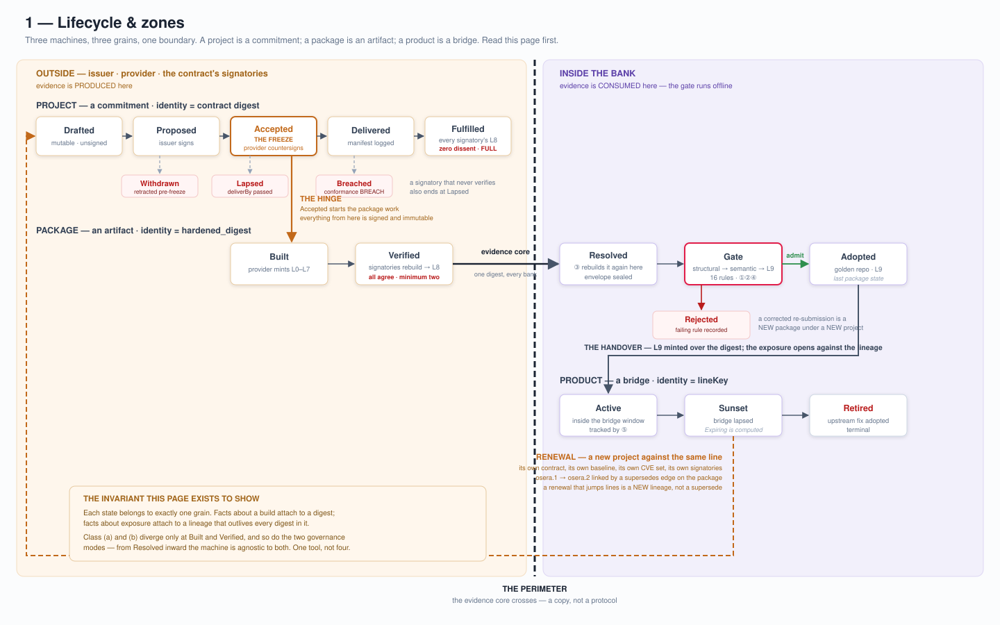
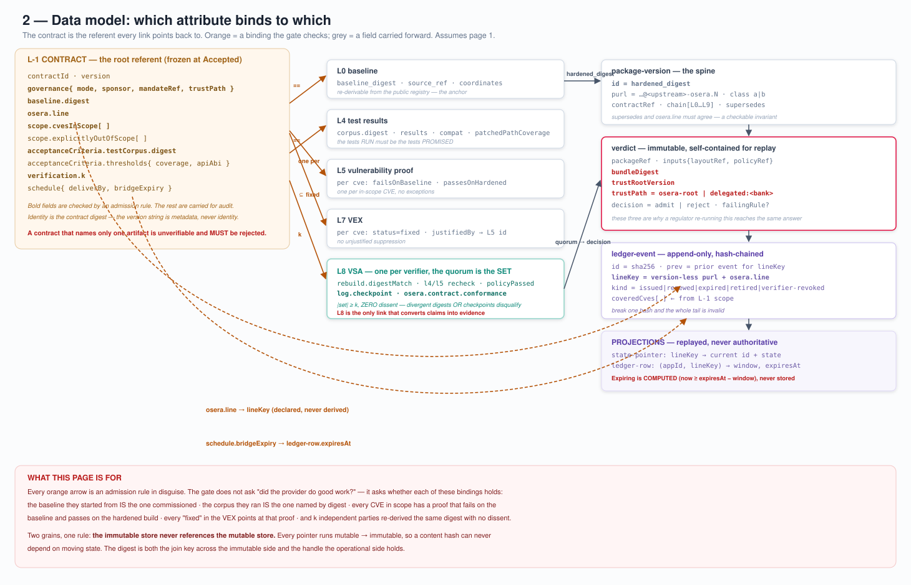
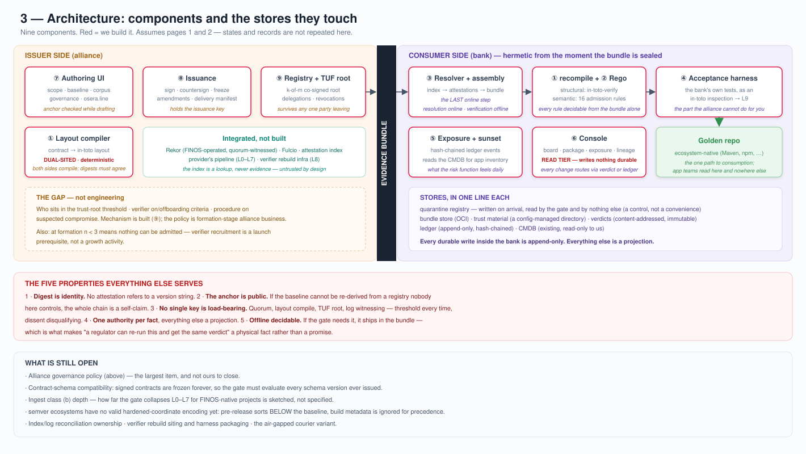
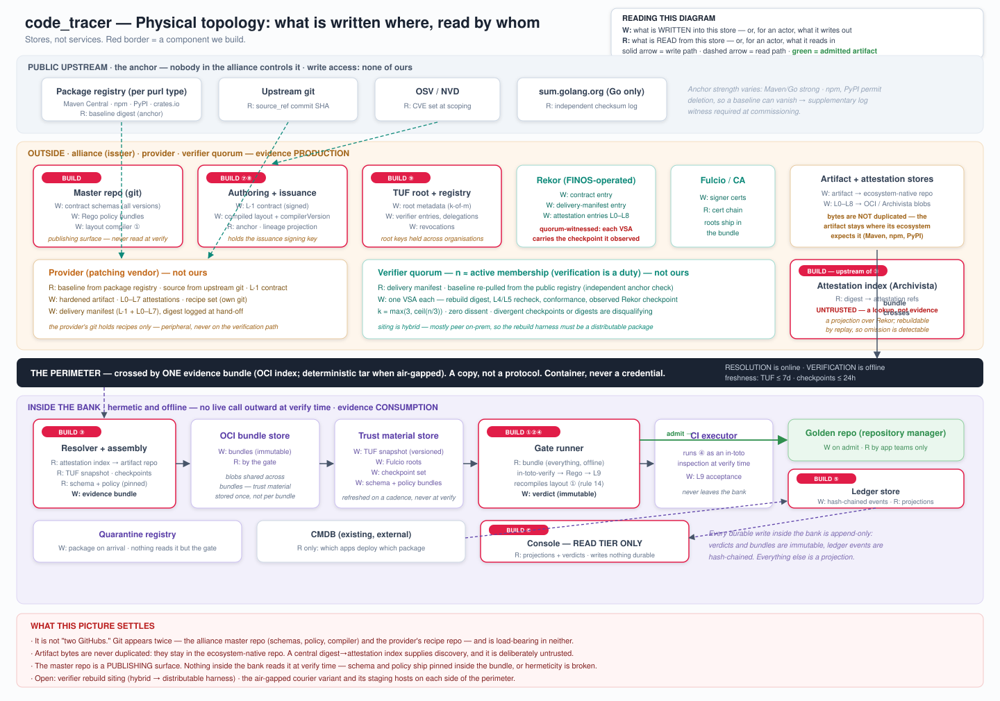

<!-- built from cd3d78363f13b195366257a7506c870932262cb3 -->

# Contract-Bound Evidence

## Admitting externally-patched open source into a regulated estate

*Working draft — 21 July 2026*

---

### Abstract

Regulated institutions run large amounts of old, widely-shared open source they
cannot upgrade on any useful timescale, because the blocking dependency belongs to
someone else. Backpatching — applying a security fix to the version actually in
use — is the available bridge, but a backpatch produced by a third party arrives
with evidence that party produced about its own work, which is not evidence at
all.

This paper describes **contract-bound evidence**: a model in which the
specification is commissioned and countersigned *before* work begins, and every
downstream claim is checked against it by parties who independently re-derived
the result. The receiving institution's question moves from *did the supplier do
good work?* — which it cannot answer — to *did the output conform to a scope the
supplier committed to before starting, independently verified?* — which is
mechanically decidable.

Two ideas do most of the work. The first is the **commissioned specification**,
which closes the loophole that makes supplier-produced test evidence
unfalsifiable. The second is the observation that **verification does not
compress**: unlike proof-of-work, checking a build costs roughly what producing
it cost, so a single checker is both a bottleneck and a single point of trust.
The response is a quorum of independent verifiers in which **disagreement is
disqualifying rather than outvoted**.

### A note on scope

The model is general. It is described here through one instance — OSERA, a FINOS
coalition mutualizing the backpatching of old open source across regulated banks
— because that instance exists, has named participants, and supplies concrete
vocabulary. Nothing in the model depends on OSERA specifically; the same
structure applies wherever an organisation must admit code that someone else
modified on its behalf, including vendor-maintained forks and internal platform
teams patching for downstream business units.

`code_tracer` is the reference implementation and is named where the distinction
between model and implementation matters.

### How to read this

**Part I** is the model and is the part most likely to transfer to other
problems. **Part II** is institutional: commissioning, trust roots, quorum
sizing — written for people deciding how an alliance should operate. **Part III**
is what a receiving institution deploys and stores — written for platform and
open-source programme teams. **Part IV** states the limits.

One worked example runs throughout: a deserialization vulnerability in a
`jackson-databind` version pinned by a framework's bill of materials, present
transitively across hundreds of applications, where the upgrade is blocked by
coupling rather than by effort.

Four figures accompany the text. Figure 1 gives the shape of the system and is
worth reading before Part I; the rest appear where they are relevant.

*Figure 1 — Lifecycle and zones.*

---

# Part I — The model

## 1. The bind

Start with the situation as it actually presents, rather than as a policy
document imagines it.

A bank runs several hundred applications. Somewhere in their dependency trees —
typically three or four levels down, arriving transitively through a framework's
bill of materials — sits a version of `jackson-databind`. No team chose it. No
team can tell you why that version rather than another. It is there because the
framework's dependency management put it there, and it has been there for years.

A deserialization vulnerability is published against it.

The remediation is obvious and unavailable. The fix exists upstream, in a later
release. Adopting that release means moving the framework BOM that pins it, which
means a coordinated upgrade across a release train no single application team
controls, scheduled against a change calendar that has other commitments. The
honest estimate is quarters, not weeks. Meanwhile the scanner fires on every
application in the estate, and the risk function has an exposure it cannot close
and cannot explain away.

This is the bind, and it is worth being precise about its shape:

- **The exposure is broad**, because the library is shared.
- **The upgrade is blocked by coupling, not by effort.** This distinction matters.
  A blocked-by-effort problem is a resourcing conversation. A blocked-by-coupling
  problem cannot be solved by the party that has the problem.
- **The window is long**, and it is measured in the calendar of whoever owns the
  blocking dependency.

The available response is a **backpatch**: take the version the estate actually
runs, apply the security fix to it, ship a hardened build under a distinct
coordinate. This is not a new technique. What it lacks, when done ad hoc, is any
basis on which a regulated institution can admit the result.

Three properties make a backpatch bearable rather than reckless. First, it is
**deliberately temporary** — a bridge to an upstream fix that will eventually be
adoptable, carrying a sunset date, because a privately-maintained fork is itself a
standing liability. Second, it is **narrow**: fix only, no features, no drift, and
provable API/ABI stability, because the whole value is that it drops into a
running estate without a code change. Third, and the subject of this paper, it
must arrive with **evidence a machine can check**.

Backpatching is also expensive and, done per-institution, absurdly duplicative:
every bank in the sector fixing the same library in parallel, each producing
evidence only it trusts. Mutualizing the work across an alliance is the obvious
efficiency. It is also what creates the problem the rest of this paper solves.
The moment the patch is produced by someone else, the receiving institution's
question changes from *did we do this correctly?* to *why should we believe
they did?*

---

## 2. Why provider-produced evidence is not evidence

The natural response is to ask the provider for proof. Publish the SBOM, the test
results, the vulnerability analysis, the build provenance — sign all of it, attach
it to the artifact, let the consumer verify the signatures.

This is better than nothing and it is not sufficient, for a reason that has
nothing to do with anyone's honesty.

**The party producing the evidence is the party being evaluated.** The provider
selects what to test, runs the tests, interprets the results, and signs the
report. Every artifact in that chain is authentic — correctly signed, untampered,
verifiable. And the chain establishes only that the provider said these things, not
that they are true.

The sharpest form of the problem is the test corpus. Consider the claim *all
tests passed*. If the corpus was chosen after the patch was written — after
someone could observe which tests the patch happens to pass — then the claim is
unfalsifiable. It is not a lie. It is a statement with no fixed referent, and it
will survive any amount of cryptographic verification, because signatures attest
to authorship rather than to adequacy.

The same structure recurs at every level. *These CVEs are fixed* — as assessed by
whom, against what scope? *No regressions* — against which baseline? *Coverage
meets threshold* — measured over which code, chosen when?

Signing solves tampering. It does not solve self-assessment. Any design that
treats a signed provider claim as evidence has simply relocated the trust
relationship into a cryptographic envelope and declared the problem handled.

Two moves fix this, and the rest of Part I is those two moves.

---

## 3. Commissioned specification

The first move: **fix the specification before the work starts, and have the provider
countersign it.**

The alliance issues a contract. It names, by content digest rather than by
version string:

- the **baseline** — the exact upstream artifact to start from;
- the **scope** — which CVEs must be fixed, and, explicitly, which present-but-
  unfixed CVEs are *out* of scope;
- the **test corpus** — named by digest, so it cannot be substituted;
- the **thresholds** — API/ABI stability required, patched-path coverage minimum;
- the **schedule** — delivery window, and the sunset date of the resulting bridge.

The provider countersigns before beginning. From that moment the deliverable is a
**commissioned specification** rather than a post-hoc submission, and the corpus
loophole closes: *all required tests passed* now has a fixed referent that was
frozen before anyone could see which tests would be convenient.

This is a small mechanical change with a large epistemic consequence. The
question the receiving institution asks moves from *did the provider do good work?* —
a judgement it is not positioned to make — to *did the output conform to a scope
the provider committed to before starting?* The second question has a mechanical
answer.

Everything downstream is checked **against** this contract rather than for
internal consistency. It is not a document that sits beside the evidence; it is
the referent every piece of evidence points back to. We call it **L-1**, the layer
beneath the chain, because the chain is verified relative to it.

Two properties of the contract matter later. It is **frozen at countersignature** —
any change is a new version with a new digest and a fresh signature, carrying an
explicit supersession pointer, so the audit trail records what changed and when.
And it is **machine-readable by construction**, because it will be compiled, not
read: a deterministic transform emits the verification policy that the receiving
institution's gate enforces. One authored artifact, two representations, the same
digest lineage. No human reads a PDF and forms an opinion.

---

## 4. The chain and the anchor

Above L-1 sits the evidence chain proper. In the OSERA instance it has ten levels
— baseline, vulnerability assessment, transformation, build provenance, test
results, vulnerability proof, SBOM and diff, VEX, verification summary,
acceptance — but the level count is not the interesting part, and a reader who
memorizes it has learned the least transportable thing in this paper.

Three principles do the work.

**Everything is digest-bound.** No attestation refers to a version string.
Subjects are content digests plus a package URL. Version strings are metadata;
they are labels for humans and dependency resolvers, never identity. This is what
makes the graph checkable rather than merely readable.

**Every link names both artifacts.** Each attestation carries both the baseline
digest and the hardened digest. A claim that names only one is unverifiable — you
cannot check *this fixes that* against a statement that mentions only *this* — and
must be rejected outright rather than accepted with reservations.

**The chain is a directed graph, not a list.** Each attestation references its
inputs by digest, so the graph is traversable from the deployed artifact back to
the upstream commit, and the traversal is enforced rather than documented.

Then there is the property everything else rests on, and it is the one most
likely to be quietly wrong.

**The anchor must be independently observable.** The first link — *this is the
upstream artifact and source commit we started from* — is a self-claim. If the
provider merely asserts it, the entire structure is a self-claim with nine extra
steps and considerably better production values. It is load-bearing only if it
can be **re-derived from public data by a party with no relationship to the
provider**: the baseline digest must match the artifact publicly retrievable from
the ecosystem's own registry at the stated coordinates, and the source reference
must be a real commit in the public upstream repository. The verifier re-pulls and
compares. No trust is required, and none is extended.

For our example this holds strongly. `jackson-databind` lives in Maven Central,
which is immutable and permits no unpublishing, so *the artifact at these
coordinates has this digest* is a durable, independently checkable fact. Not every
ecosystem gives this for free, and Part IV returns to what changes when it does
not — the strength of the anchor turns out to determine which ecosystems this
model can support at all.

---

*Figure 2 — Data model: which attribute binds to which.*

---

## 5. Verification does not compress

The second move is the one with the widest application beyond this domain, and it
begins with an analogy that fails instructively.

The situation resembles a problem distributed systems has thought about
carefully: parties who cannot fully trust each other need to agree on a fact.
Something transplants from that literature, and something crucial does not.

**What transplants:** *verify, don't trust*, and the observation that
deterministic processes let any party re-derive an answer independently. If a
build is reproducible — bit-for-bit identical given identical inputs — then any
party with the inputs can rebuild and compare digests, and agreement is a matter
of arithmetic rather than authority.

**What does not transplant:** consensus machinery. There is no double-spend
problem here, no scarce resource being allocated, and the alliance is a
legitimately trusted neutral venue rather than an adversarial anonymous network. A
consensus protocol would solve a problem this domain does not have while adding
latency a release SLA cannot absorb. Hash-linked, append-only, tamper-evident
logs: yes, unreservedly. Distributed consensus, canonical-chain agreement,
tokens: no, and the distinction is worth stating plainly because the vocabulary
invites conflation.

Now the failure of the analogy, which is where the design turns.

In proof-of-work, the asymmetry is the entire point: work is expensive to produce
and **cheap to verify**. Anyone can check a hash in microseconds. That asymmetry
is what lets a network converge cheaply.

**Here there is no asymmetry. Verification does not compress.** Reproducing a
build and re-running a test suite costs approximately what producing it cost. A
verifier is not a cheap checker; it is a second provider doing the same work and
comparing notes.

Two consequences follow, and they point in the same direction.

First, a single verifier is a **throughput bottleneck** — it must do the full work
of production for every artifact in the pipeline.

Second, and more seriously, a single verifier is a **single point of trust**.
Separating provider from checker hardens the design against provider compromise and does
exactly nothing about checker compromise. Compromise one verifier's signing keys
or build infrastructure and the entire model collapses in one move — with the
receiving institutions seeing a perfectly valid signature over a perfectly false
claim.

**The fix is a quorum, not a chain.** Because reproducible builds are
deterministic, independent verifiers converge on the same digest **without
coordinating**. There is no protocol between them, no messages, no leader. The
correct answer is a natural focal point — the one result every honest party
independently arrives at — and agreement is an artifact of determinism rather than
of negotiation. Each verifier publishes its own signed verification summary, and
admission requires the whole set to agree.

The most important design decision in this paper is what happens when they
disagree.

**Dissent is disqualifying, not outvoted.** If five institutions rebuild and four
agree while one produces a different digest, the honest reading is *not* four
against one. It is that something is wrong — either the toolchain specification is
underdetermined and the build is not as reproducible as claimed, or something
considerably worse — and either way the receiving institutions need to know
loudly, before promotion. So the rule is **unanimity across the verifier set**,
never a simple majority. A dissenting verification summary triggers investigation,
not arithmetic.

This inverts the usual instinct. Majority voting is designed to *tolerate*
disagreement and produce an answer anyway. Here, disagreement is the most valuable
signal the system can generate, and a design that averages it away has discarded
its own best alarm. It is also a signal **no single-checker design can produce at
all** — with one verifier there is nothing to disagree with — and that, more than
throughput or redundancy, is the strongest argument for the quorum.

Two practical notes. Who sits in that set, and how large it needs to be, is
settled in Part II: the short version is that verification binds to the parties
that sign and fund the contract, so the set is **named rather than sized**. And
that set is **frozen into the contract at issuance**, so an artifact is judged
against the parties who committed to it rather than against a membership that
drifted afterwards.

One further reproduction happens later and matters more than its position
suggests: the institution that adopts the package rebuilds it again, inside its
own perimeter, before admitting it. Part III describes where that sits and why it
is what makes the whole arrangement work for a package only one institution
commissioned.

---

Part I establishes the model: commission the specification before the work,
anchor it in publicly observable fact, and require independent reproduction with
zero dissent. Part II turns to who commissions, who verifies, and how the trust
root survives the parties that hold it. Part III is what a receiving institution
actually deploys.

---

# Part II — Commissioning and trust

Part I described the model. This part is about the institutional machinery
underneath it: who decides what gets commissioned, who checks the result, what
happens when a commitment is not met, and how the trust root survives the
organisations that hold it. These are governance questions, and they are the ones
an alliance has to settle before any of the engineering matters.

---

## 6. Issuance, and what happens when delivery falls short

The contract has its own lifecycle, separate from the artifact's. It is drafted,
proposed to the provider, accepted when the provider countersigns, delivered, and
finally fulfilled when the verifiers confirm conformance. It can also be
withdrawn before acceptance, breached on delivery, or lapse if the delivery
window passes with nothing produced.

**Acceptance is the hinge.** Before it, the draft is mutable and internal to the
issuer. From it, scope, baseline, corpus and thresholds are frozen and signed,
and the artifact lifecycle begins. Everything Part I claims about commissioned
specification rests on that one transition being clean.

The hand-off at delivery deserves a note, because it closes a loophole one layer
out from the corpus problem. The provider assembles a **delivery manifest** — the
contract plus its own attestations — and its digest is written to a transparency
log. This establishes that this exact set existed at this time, and it stops the
provider adjusting the submission after seeing how verification went. Deliberately,
the freeze is a log entry rather than a signature: an inclusion proof cannot be
misread as anyone's endorsement of the contents.

### Conformance is binary

Verification reports conformance as full, partial, or breach. Only **full**
admits. Partial and breach never promote, under any circumstance.

This looks harsh, and working groups reliably propose softening it: surely a
backpatch that fixes four of five commissioned CVEs is better than nothing, and
surely the receiving institution should be allowed to weigh that for itself.

The argument against is that a discretionary middle state destroys the property
the contract was created to establish. Once *partial* can promote, someone has to
decide which partials are acceptable — and that decision is exactly the
unstructured judgement the commissioned specification removed. It also puts the
decision in the wrong place: the receiving institution's gate would be
adjudicating whether the alliance's commissioning was met, artifact by artifact.
And the contract is on a trajectory toward executable terms, where a
discretionary state has no representation at all.

**An honest shortfall routes through amendment.** If a fifth CVE proves
unfixable, the contract is amended: that CVE moves to the explicitly-out-of-scope
list with a stated reason, the provider countersigns the new version, and delivery
is then *full* against a contract that tells the truth. The residual exposure is
recorded in a signed document that the receiving institution can read, rather
than buried inside a softened verdict.

This is the better outcome for the same reason double-entry bookkeeping beats a
fudge: the shortfall becomes visible and attributable instead of absorbed. The
cost is process friction — an amendment cycle takes days that a verdict override
would take minutes — and that friction is the mechanism working.

Amendments are versions of the same commitment, carrying an explicit supersession
pointer, so the record shows what changed and when. This is distinct from
renewal, which produces a *new* commitment in the same lineage when a bridge
expires. Collapsing the two would lose the distinction between "we changed what
we asked for" and "we asked again, later."

---

## 7. A trust root that outlives its holders

Everything in the model reduces to a question of key management: which signatures
does the receiving institution's gate accept, and who decides?

The naive answer is that the alliance holds the root key. This fails on
continuity. Alliances form, merge, restructure and dissolve. If the root sits
with a single organisation, then every artifact ever admitted becomes
unverifiable the moment that organisation ceases to exist — not because anything
was wrong with the artifacts, but because the trust material can no longer be
re-signed. Root metadata carries an expiry, so this is a scheduled failure rather
than a hypothetical one.

**So the root is co-signed by a threshold of parties spanning the alliance and
its member institutions.** Re-signing requires k of m, so it survives any single
party disappearing, and no single compromised key can rotate the root. This is
the same shape as verification, applied to trust material — the design uses
thresholds wherever a single key would otherwise be load-bearing.

### Bilateral work needs a delegated namespace

Not all work is commissioned collectively. An institution may contract a provider
directly, for a library only it cares about. That work should not be signed under
the alliance's root, because the alliance did not commission it and cannot stand
behind the judgement.

The established mechanism handles this: **delegation**. The root delegates a
namespace to a named institution, which signs its own bilateral work. The
delegation is visible in the trust metadata, so a receiving institution can see
which path an artifact arrived by. Importantly, a delegate cannot sign a new
root, which keeps the blast radius of a compromised delegation contained.

### No weaker tier

The tempting design here is a tiered one: artifacts over the alliance root get
full trust, delegated artifacts get a reduced check or an extra approval step.

That would be a mistake, and the reason is worth stating plainly. The admission
rules verify properties of the artifact and its evidence: that the baseline
anchors publicly, that the proofs hold, that independent parties re-derived the
result. None of those properties depend on who commissioned the work. A tier
system would therefore either apply a check that adds nothing, or relax one that
mattered — and relaxing it would mean the strict version was never necessary.

The trust path is recorded on the verdict for **attribution**. It tells you who
stood behind the commissioning judgement, which is genuinely useful when
something goes wrong. It does not alter what the gate requires.

One honest qualification, developed in §8: the *rules* are identical across
paths, and so is the work the receiving institution does. What varies is how many
independent reproductions accompanied the artifact before it arrived.

The related decision concerns the transparency log. A shared log operated by the
alliance is convenient, but a log operator can in principle present different
views to different parties. Rather than adding a separate witness network, each
verifier records the log state it observed at the time of verification, and those
observations travel with the evidence. Agreement across the verifiers makes a
split view detectable, using machinery already present for other reasons.

---

## 8. Who verifies, and how many

The unresolved question in early drafts was what motivates an institution to
verify someone else's artifact. The first answer was to make verification a
credit — count it against membership dues, so institutions that verify pay less.

That answer collapses on contact with bilateral commissioning. If verification
earns credit and an institution can commission alone, the rational strategy is to
commission solo and never verify, which starves the verifier pool precisely when
it is needed. Worse, the institutions most able to verify are the ones most able
to go it alone.

The second answer was to make verification an obligation of membership: members
verify what the alliance commissions, and the cost is a CI job. That works, and
it has an awkward edge — it conscripts institutions into checking projects they
neither asked for nor consume, and it leaves unanswered which member checks which
project.

**The answer the model settles on is that verification follows the money.** The
institutions that sign and fund a contract are the institutions that verify it.
All of them verify, all must agree, and a collectively-commissioned project needs
at least two signatories to exist at all.

The argument is that financial exposure is a firmer binding than an obligation.
A signatory has already accepted the cost, and it will run the result in its own
estate, so it carries the consequence of a bad patch twice over. It also disposes
of the assignment problem: there is no rule needed for who checks what, because
the contract already names them, and no project can stall waiting for a volunteer.

The cost is a sunk-cost pull in the other direction — a funder that needs the
package in production has some motive to see it pass. What holds the line is that
the comparison is digest equality, with nothing to interpret or soften.

### How many is enough

Earlier drafts set a floor of three, justified on the grounds that two verifiers
disagreeing give no way to tell which is wrong without a third.

That justification does not survive inspection, because **nothing in this design
arbitrates**. Disagreement is disqualifying rather than resolvable: two agree and
the package admits, two disagree and it stops, and five would behave the same
way. The third verifier was never going to break a tie, because there are no ties
to break.

What two rather than three does cost is compromise resistance — one bad signer is
half the outside evidence rather than a third of it. That is accepted, and the
reason it is acceptable is the next section.

### The receiving institution verifies too

The strongest reproduction in the model is the one nobody commissioned.

**Every adopting institution rebuilds the package itself**, from source and
toolchain references pinned by digest in the evidence, and signs its own
verification summary. This happens while it is still online, during resolution,
before the evidence is sealed for offline verification — so the gate still decides
from a sealed bundle and the decision is still replayable.

This is what makes a solo-commissioned artifact consumable without a weaker tier.
A solo project has one signatory and therefore one reproduction before the
perimeter; the maker and the checker are separated *at the point where the
decision is made* by the institution taking the risk. And it is why a revoked
verifier key does not unravel past admissions: whatever happened outside, the
receiving institution had rebuilt the package for itself.

The honest cost is that verification does not compress for consumers either.
Each adopting institution pays roughly production cost per package. Sampling
would reduce it and would make the work differ by commissioning mode, which is
the distinction this design refuses to draw.

**The threshold in force is frozen into the contract at issuance**, along with
the signatory set. An artifact is judged against the parties who committed to it
when it was commissioned, rather than against a set that drifted during the work.

One consequence has to be stated because it affects formation planning: a
collectively-commissioned project cannot begin until a second institution will
co-fund it. Co-funding is therefore a launch prerequisite, and an alliance that
signs a provider before it has members willing to pair up will have commissioned
work under contracts that cannot reach fulfilment.

---

Part II settles the institutional questions: a commitment that freezes on
countersignature, a shortfall that surfaces as an amended contract, a trust root
that survives its holders, and verification bound to the parties that pay for the
work and then rebuilt again by whoever adopts it. Part III is what a receiving
institution deploys.

---

# Part III — Admission and afterlife

Parts I and II described a model and who operates it. This part is about what a
receiving institution actually runs, what it stores, and what it is still on the
hook for a year later. The short version is that the gate is smaller than people
expect and the afterlife is larger.

---

*Figure 3 — Architecture: components and the stores they touch.*

---

## 9. The contract compiles to a policy

The L-1 contract is machine-readable for a specific reason: it is **compiled, not
read**. A deterministic transform turns the signed contract into the verification
policy the gate enforces. One authored artifact, two representations.

This matters because the alternative — a human reading a contract and configuring
a gate to match — reintroduces exactly the gap the contract was written to close.
An operator who mistypes a threshold, or who configures last quarter's scope,
produces a gate that passes artifacts the contract would have rejected, and
nothing in the system notices.

**Both sides compile, and the digests must agree.** The issuer compiles the
policy and distributes it. The receiving institution **recompiles it locally from
the same signed contract** and compares digests. A mismatch is a failed
admission.

The temptation is to skip this: the issuer signs the compiled policy, so why not
just verify the signature? Because a signature establishes *authorship*, not
*correctness*. Accepting a signed policy without recompiling inserts a trusted
compiler into a design whose entire premise is that you verify rather than trust.
Recompilation costs milliseconds and removes a component from the trusted set —
one of the better trades in the design. It does impose a real engineering
constraint: the compiler must be **byte-deterministic**, which means no
timestamps, no map iteration order, no environment leakage. The compiler version
travels with the policy so that a version skew surfaces as a digest mismatch
rather than as silent divergence.

### Structure and meaning are different checks

Verification runs in two passes, and the split is not arbitrary.

The **structural** pass asks whether the right steps ran, in the right order,
signed by the right parties, with the graph intact and thresholds met. It is a
graph and signature check. It knows nothing about vulnerabilities.

The **semantic** pass asks whether the evidence *means* what the contract
requires: that the CVEs proven fixed cover the commissioned scope, that the test
corpus matched by digest, that coverage cleared its threshold, that conformance
is `FULL`, and that each vulnerability record the scope cites still reads as it
did when the work was commissioned.

That last check deserves a note, because it closes the final place the contract
rested on an author's claim. The affected-version range written into the scope is
written by whoever drafts the contract, and nothing checked it against the
advisory it cites. So the advisory record is **pinned at commissioning** and
travels inside the evidence, and the gate confirms the range the contract asserts
against the copy that was frozen. Verification runs against that copy rather than
the live feed on purpose: advisory records legitimately move, a range widened six
months later is enrichment working correctly, and gating on it would refuse a
conforming artifact over something the provider never controlled. Drift since
commissioning belongs to the ledger as an exposure finding.

Keeping the two passes separate has a practical payoff. The structural layer is a
mature, general-purpose framework that this design consumes unmodified. The
semantic layer is a policy file — readable, reviewable, diffable, and modifiable
by a security engineer without touching verification machinery. When a bank's
risk function asks *what exactly does the gate check?*, the answer is a file they
can read, not a codebase they have to trust.

For the running example: the structural pass confirms that a rebuild step ran and
was signed by three registered verifiers. The semantic pass confirms that the
deserialization CVE named in the contract has a proof that fails on the baseline
`jackson-databind` and passes on the hardened one, and that the corpus those
results came from is the corpus the contract named.

---

## 10. The perimeter

Because verification is hermetic and offline, the boundary crossing cannot be a
protocol. There is no live call to the alliance at verification time. What
crosses is a **copy of a self-contained, content-addressed set of files** — the
evidence bundle.

This produces the design test the whole interface is built around: **if the gate
needs it, it ships in the bundle.** Anything the gate would have to fetch is a
live dependency, and a live dependency means the decision cannot be replayed
later from stored inputs. Every admission rule must be decidable from bundle
contents alone; a rule that isn't is either a wrong rule or a missing bundle
element.

**It arrives in two parts, assembled by two parties.** The alliance seals an
**evidence core** once per fulfilled contract — the provider's attestations, the
verifiers' summaries, the signed contract, the compiled policy, and a pinned copy
of each vulnerability record the scope cites. None of that ages, so the core
carries no expiry and can be cited years later. The receiving institution then
wraps it in an **ingest envelope** holding what is needed to judge those
signatures today: a trust-root snapshot, log checkpoints, certificate roots, and
where the artifact sits locally.

The split earns its cost in a single property. The core has one digest, identical
for every institution that receives it, so two of them can establish that they
admitted the same evidence — a comparison that assembling per-institution would
make impossible, since it would produce as many identifiers as recipients over
one set of facts. It also puts each clock where it belongs: the evidence has
none, and the material used to judge it is refreshed locally on a schedule.

**Sealing confers no authority.** Neither part carries a signature of its own,
and packaging evidence establishes nothing about it — every element inside is
independently signed and independently verified. This keeps assembly from
becoming a trust role: the party that packages the evidence gains no power over
whether it is believed, which is what allows the envelope to be assembled inside
the receiving institution without anyone having to vouch for the assembler. One
engineering consequence follows directly, because the pinned advisory records are
digested exactly as they are carried: assembly must preserve those bytes
verbatim, with no reformatting or re-encoding in any transport form.

**Resolution is online; verification is offline.** Discovering which attestations
belong to an artifact digest requires a lookup, and that lookup happens *before*
the bundle is sealed. Once sealed, nothing else is consulted. The perimeter is
that line, not the institution's firewall. This distinction is what allows a
central discovery index to exist without compromising hermeticity: the index is a
lookup rather than evidence, no admission rule depends on it, and a wrong answer
fails immediately against signed, digest-bound attestations.

**Offline verification forfeits freshness**, which has to be handled explicitly.
A trust-root snapshot pinned into a bundle cannot learn that a verifier key was
revoked yesterday. So the envelope carries stated maximum ages — a longer clock
for the trust root, a much shorter one for transparency-log checkpoints — and
exceeding either is a **named-rule rejection, not a warning**. A warning defers
the decision to whoever is reading the console, which is not a control.
Re-resolution is cheap, because only the trust material needs refreshing; the
core and the artifact are unchanged.

*Figure 4 — Physical topology: what is written where, read by whom.*

### What you actually deploy

This is the part most likely to surprise a platform team, and it is the strongest
adoption argument in the model.

**The gate is a CI job.** It invokes a general-purpose attestation verifier for
the structural pass and a policy engine for the semantic pass. Most regulated
institutions already run both — the policy engine is frequently already deployed
for Kubernetes admission control. The gate is stateless: it reads a bundle and
writes a verdict.

**The storage is unremarkable.** A quarantine repository for arriving packages,
which nothing but the gate may read. A registry for bundles. A directory of trust
material — a trust-root snapshot, certificate roots, checkpoints, the schema and
policy the bundle pinned — refreshed on a schedule under ordinary configuration
management, not a service. An append-only ledger. The existing repository manager
serves as the golden repository, unchanged.

**The one-reader rule on quarantine is a control, not a convenience.** If any
other system can read the quarantine repository, an application team can consume
an unadmitted artifact by pointing at the wrong repository, and every guarantee
in this paper evaporates without a single check failing.

What is genuinely new is short: the contract-to-policy compiler, the semantic
policy itself, the resolver that assembles bundles, the harness that runs the
institution's own acceptance tests as a verification step, and the ledger. That
is a small surface, and none of it is exotic infrastructure.

**The institution's own tests are not optional.** They run *inside* the gate, as
a verification step whose result folds into the admit-or-reject decision rather
than as a separate downstream stage. The reasoning is uncomfortable but sound:
under a warranty-free distribution model, nobody is contractually answerable when
a conforming backpatch nonetheless breaks production. A conforming artifact is
not the same as a compatible one, and compatibility with a particular estate is
the one thing the alliance cannot test on anyone's behalf. This step never leaves
the institution and is never shared.

---

## 11. Bridges expire

Admission is the beginning of the obligation, not the end of it. A backpatch is
deliberately temporary — a bridge to an upstream fix that will eventually be
adoptable. An institution that admits bridges without tracking their expiry has
replaced a known vulnerability with an unmanaged dependency on a third party's
continued goodwill, which is not obviously an improvement.

So the ledger is not a reporting nicety. It is the half of the system the risk
function touches daily, and it answers a question the gate cannot: *what are we
running now, what does it cover, and when does it lapse?*

**The ledger is an append-only, hash-chained event log**, with everything else
computed from it. Events record issuance, renewal, expiry, retirement, and
verifier revocation. Current state is a projection replayed from the chain rather
than a stored row.

The reason is an audit question that a last-write-wins table cannot answer:
*which bridge was in force in March, and exactly which CVEs did it cover?* A
mutable status column knows only the present. An event chain replays to any past
date. Since the entire model exists to make regulatory claims defensible, storing
the operational half in a form that forgets its own history would be a strange
place to economize. The chaining also makes tampering detectable — break one link
and the whole tail is invalid — which is the same discipline the attestation
chain uses, applied to the institution's own records.

One consequence worth stating: **"expiring soon" is computed, never stored.**
Deriving it from the expiry date and a warning window avoids a mutable status
that would need its own writer and its own clock, and therefore its own failure
mode.

### Renewal is a new artifact, not a status change

When a bridge approaches expiry and upstream still isn't adoptable, the response
is a **renewal** — and a renewal is a new package that supersedes the old one,
not a date extension on the existing one.

This is not bookkeeping pedantry. The second bridge has its own commissioned
contract, its own baseline, and very often a *different* CVE set — for a library
with recurring deserialization issues, bridge two typically closes vulnerabilities
that did not exist when bridge one was commissioned. Treating that as "the same
bridge, extended" would erase precisely the information the ledger exists to
retain. The two are linked by an explicit supersession pointer and share a stable
lineage key, so the chain is traversable while each link remains distinct.

### Revocation records an exposure; it does not invalidate

When a verifier's key is revoked, what happens to the artifacts admitted on that
verifier's summaries?

They **stay admitted**. Admission was valid at the time, against a pinned
trust-root version, and the artifacts themselves are unchanged — they still
rebuild to the same digest and still prove the same vulnerabilities fixed. The
event is recorded against every affected lineage, and the console raises a review
trigger for the risk function to judge case by case.

The alternative is worse than it first appears. Automatically invalidating
everything a revoked key touched would let a single trust event pull hundreds of
packages out of production simultaneously — a self-inflicted outage triggered
by key hygiene rather than by any defect in an artifact. This is tolerable
precisely because of the zero-dissent quorum: with a floor of three independent
verifiers and no disagreement permitted, no single verifier was ever the sole
basis for an admission.

**The console writes nothing durable.** It is a read tier over projections and
verdicts. Every state change routes through the gate, which writes a verdict, or
the ledger, which appends an event. This is what keeps the audit trail complete:
there is no path by which someone clicks a button and changes the record.

---

## 12. Which ecosystems this works for

The model is ecosystem-agnostic in principle and constrained in practice, and the
constraint sits in two places that are easy to miss.

**Anchor strength varies.** The first link in the chain is only load-bearing if
the baseline can be re-pulled from a registry nobody in the alliance controls.
Some registries are immutable and permit no unpublishing, so *the artifact at
these coordinates has this digest* is durable. Go goes further, publishing an
independent checksum log that is stronger than anything this design constructs by
hand. But **npm and PyPI permit deletion**, which means a baseline can vanish
after the fact and the anchor check becomes unrepeatable. Those ecosystems need a
supplementary witness recorded at commissioning, so that *this digest was the
published artifact at time T* survives removal.

**Reproducibility gates feasibility.** Independent verification requires that
rebuilds converge bit-for-bit. This is workable in the Java ecosystem, good in Go
and Rust, and materially harder in npm and Python, where builds routinely embed
timestamps, absolute paths, and platform detail. Without reproducibility there is
no digest agreement, therefore no quorum, therefore no admission. Ecosystem
support is a **feasibility question, not a sequencing preference** — an ecosystem
is supportable when its builds can be made reproducible, and not before. Stating
this plainly avoids promising support the verification model cannot deliver.

There is a third constraint, smaller but sharp. The hardened artifact needs a
coordinate that sorts **above** its baseline in the ecosystem's own version
ordering, never collides with a real upstream release, and increases across
renewals. In Maven's version grammar a qualifier suffix satisfies this. Under
PEP 440, a local version identifier does. **Under semver, neither form works**: a
pre-release suffix sorts *below* the base version — so a resolver would treat the
hardened artifact as older than the vulnerable one it replaces — and build
metadata is ignored for precedence entirely. That is an open problem, and it may
constrain which ecosystems are viable regardless of reproducibility.

Adding an ecosystem is therefore a deliberate act with four prerequisites: an
anchor class, reproducible builds, a valid coordinate encoding, and a way to
carry attestations.

---

Part III is the deployable half: a compiled policy, a bundle that crosses once, a
gate built largely from software the institution already runs, and a ledger that
outlives the admission decision by design. Part IV is what the model does not do.

---

# Part IV — Limits

## 13. What this model does not do

A design paper that lists only its strengths is asking to be believed rather than
checked. This part states the limits plainly. Some are open problems that further
work could close; two are structural, and no amount of engineering will remove
them.

### A faithful build of a malicious change passes every check

This is the sharpest limit, and it follows directly from what reproducibility
proves.

Independent rebuild establishes that the artifact corresponds to the stated
inputs: this source, this transformation, this toolchain, producing exactly these
bytes. Every verifier confirming the same digest confirms that the provider's
described change was applied faithfully and that nothing else was introduced
during the build.

It says nothing about whether the change itself is benign. A provider who inserts a
backdoor *into the declared transformation* produces an artifact that rebuilds
identically for every verifier, passes the vulnerability proofs, passes the test
corpus, and conforms perfectly to the contract. The quorum will agree, correctly,
that this is what the recipe produces.

The model therefore shifts the trust question rather than eliminating it: from
*did the provider test adequately?* — which it answers well — to *is the provider
acting in good faith?* — which it does not address at all. Source review of the
transformation remains a separate control, and the contract's requirement that
the recipe set be content-addressed exists to make that review possible and
repeatable. An alliance that treats independent verification as a substitute for
looking at the patch has misread what the verification proves.

### Verifiers may fail in correlated ways

The quorum assumes independence. In practice, verifiers are likely to run similar
toolchains, similar container images, and a shared rebuild harness distributed by
the alliance — because that is the cheapest way to make verification a low-effort
membership obligation.

A defect in that shared harness is a common-mode failure. Every verifier could
converge on the same wrong answer with no dissent, which is exactly the signal the
design relies on to detect trouble. The mitigation is partial: encourage
diversity in build environments, and treat the harness as security-relevant code
in its own right. But the tension is real, and it runs against the operational
pressure to standardise.

### The quorum verifies conformance, not judgement

Verification confirms that delivery matched the contract. Nobody independently
checks that the contract asked for the right things.

If the commissioned scope omits a CVE that mattered, or names a test corpus too
weak to catch a regression, every downstream check will pass and the artifact
will be admitted. The scope decision sits with the issuer and, in solo mode, with
a single institution. That decision is recorded and attributable — the governance
block makes it checkable after the fact — but it is not verified by anyone before
the work proceeds.

### Open problems

**Version coordinates in semver ecosystems.** The hardened artifact needs a
coordinate sorting above its baseline. Under semver, a pre-release suffix sorts
below the base version and build metadata is ignored for precedence, so neither
available form works. Until this is resolved, npm and cargo cannot be supported
even where reproducibility is achievable.

**Schema compatibility over time.** Signed contracts are frozen permanently and
the ledger must answer questions about them years later, so the gate has to
evaluate every schema version ever issued. Nothing can be deprecated. The
versioning and compatibility rules for that schema are unspecified, and the
problem only becomes visible once both sides ship independently.

**Anchor durability in deletion-permitting registries.** npm and PyPI allow
unpublishing, so a baseline can disappear after commissioning and the anchor
check becomes unrepeatable. The proposed remedy — recording a log witness at
commissioning — is sound but adds a step that must actually be performed, at the
moment when nobody yet has a reason to care.

**Reconciliation of the discovery index.** The central attestation index is
rebuildable from the transparency log, which is what makes omission detectable
rather than silent. Detectable, however, only if someone performs the
reconciliation. The operating model proposes an owner and a daily cadence, with
the resulting lag published as a figure so the distance between log and index is
visible rather than assumed. Neither the owner nor the interval is settled, and
until they are this is a duty nobody holds — which is the failure mode the whole
class of standing obligations shares: nothing rejects, nothing alarms, and the
omission surfaces only when a package cannot be discovered.

**Governance policy.** Who sits in the trust-root threshold, how verifiers are
admitted and removed, and what happens on suspected compromise are undecided.
These are the largest remaining items and they are not engineering questions.

### Two things the model deliberately does not attempt

**It is not a substitute for upgrading.** Every bridge carries an expiry, and the
ledger exists to make expiry impossible to ignore. An institution that renews
indefinitely has built a permanent private fork with extra ceremony, which is a
worse position than the one it started from — the model can make that visible,
but it cannot prevent it.

**It offers no warranty.** A neutral venue distributing hardened open source will
not warrant fitness, and nobody is contractually answerable when a conforming
backpatch breaks production. The contract narrows what has to be accepted on
faith — *as-is, but provably conforming to a scope committed in advance and
independently re-derived* is a much better as-is than *as-is, trust us* — but a
risk function still has to accept it, in writing.

### At formation, nothing works

Until three verifiers are active, no artifact can reach full admission. An
alliance that commissions work before recruiting verifiers will have paid for
artifacts nobody can consume. Verifier recruitment is a launch prerequisite, and
it is easy to mistake for a growth activity because the machinery looks complete
without it.

## Appendix A — Figures

All four figures, and the sources they are generated from, are in
`docs/resources/`. Where a figure and the design records disagree, the records are
authoritative.

| Figure | Answers |
|---|---|
| 1 — Lifecycle and zones | What states exist, and where the boundary falls |
| 2 — Data model | Which attribute binds to which; every arrow is an admission rule |
| 3 — Architecture | The components, and the stores they touch |
| 4 — Physical topology | Where the bytes actually live, and who reads them |

## Appendix B — The admission ruleset

The gate evaluates the ruleset in two passes, structural then semantic. It is
enumerated in full in `artifact-architecture` §3.7, which is the only place the
rules are numbered or counted. A count printed in prose drifts from the artifact
it summarises, and this appendix drifted once already — it described the ruleset
as it stood before advisory-record integrity was added.

The rules divide into groups. **Signature and log validity** covers envelopes,
certificate chains, log inclusion and the witnessed checkpoint set. **Verifier
quorum** requires k distinct registered verifiers with no dissent. **Anchor
re-derivability** requires the baseline to resolve publicly, with a supplementary
log witness in ecosystems that permit deletion. **Graph and digest-binding
integrity** covers the unbroken chain back to that anchor. **Contract
conformance** covers scope, corpus, proof completeness, exploitability status and
the binary conformance verdict. **Compile agreement** has both sides compile the
policy from the signed contract and compare digests, so a signed layout is
verified rather than merely authenticated. **Bundle freshness** bounds the age of
the trust material, since offline verification forfeits the trust root's own
currency guarantee. And **advisory-record integrity** pins the vulnerability
record each scope entry cites at commissioning and digests it as carried, so the
affected range the contract asserts is checkable rather than the author's word.

Every rule must be decidable from the evidence bundle alone. A rule requiring a
live lookup is either wrong or evidence of a missing bundle element, and that
test is what keeps the hermeticity claim falsifiable rather than aspirational.

## Appendix C — Status

This is a working draft circulated for comment. Parts I–IV are drafted; the
worked example's CVE identifiers and version numbers are deliberately absent and
must be verified against a live source before publication.

The design records this paper is drawn from — including the decisions it
summarises and the open questions it lists — are maintained as a content-addressed
graph under `.konspekt/instance/`. Where this paper and those records disagree,
the records are authoritative and this paper is stale.